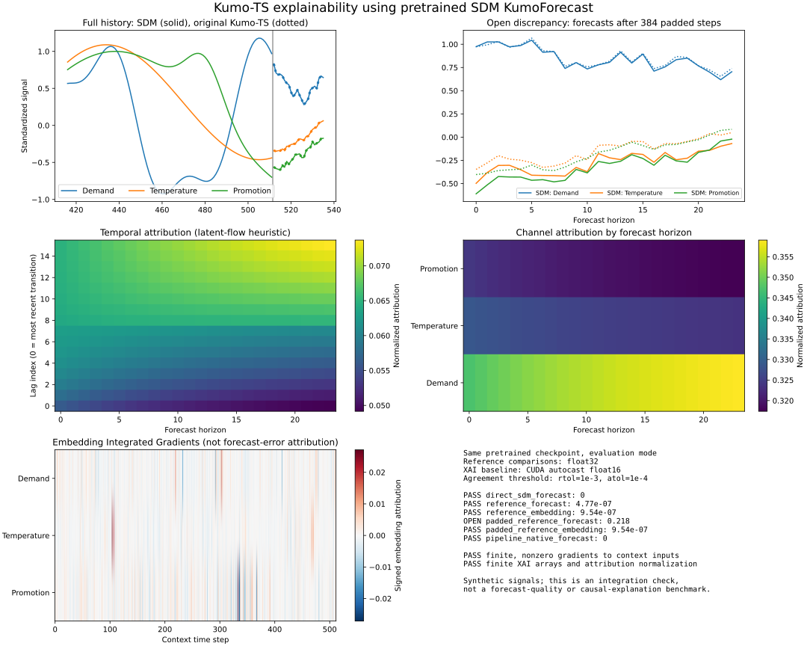

# SDM interpretability proof

This branch preserves the local Kumo-TS changes that accept an SDM `KumoForecast` through its forward interface and extract embeddings with a temporary encoder hook. The example uses pretrained weights and produces a visual comparison plus machine-readable evidence.



## Run

From `Kumo-Forecast/`, prepare a Python 3.11 environment and install the pinned SDM revision containing the leading-padding attention-mask fix from [SDM PR #1338](https://github.com/NVIDIA/structured-data-models/pull/1338):

```bash
uv sync --frozen --python 3.11
uv pip install --python .venv/bin/python \
  'pyarrow==19.0.1' \
  'structured-data-models @ git+https://github.com/NVIDIA/structured-data-models.git@083995260db6762bb8cb4f111098bd1e16bfd643' \
  matplotlib
.venv/bin/python examples/sdm_interpretability_proof.py \
  --output examples/sdm_proof/snapshot
```

The first run downloads the original MOMENT backbone and the Kumo-Forecast checkpoint. `--offline` restricts the original reference loader to already cached files. The demonstration was run on an NVIDIA L4 with PyTorch `2.12.1+cu130`. CPU execution is supported via `--device cpu`, with a longer runtime.

The example generates `overview.svg`, `overview.png`, `results.json`, and `arrays.npz`. The SVG and JSON snapshot are committed; the PNG and numerical arrays can be regenerated. `results.json` records the SDM revision, immutable checkpoint revision, precision, source hashes, array shapes, and comparison tolerances.

## What is checked

The input is a deterministic synthetic three-channel series in standardized units, matching the existing Kumo-TS interpretability boundary. The integration uses an identity SDM recipe to avoid standardizing it a second time. Both implementations load `run8_best_model_cr.pt` from the same immutable Hugging Face revision.

| Check | Recorded result |
| --- | --- |
| Integration forecast versus direct SDM forward | Maximum absolute error `0` |
| Full-history forecast versus original Kumo-TS | Maximum absolute error `4.77e-7` |
| Full-history embedding versus original Kumo-TS | Maximum absolute error `9.54e-7` |
| Padded-history embedding versus original Kumo-TS | Maximum absolute error `9.54e-7` |
| Explanation baseline versus direct SDM at matching precision | Maximum absolute error `0` |
| Gradient from the embedding to context inputs | Finite, nonzero; norm `4.21` |
| Embedding Integrated Gradients, 32 steps | Finite `[3, 512]` attribution; relative completeness residual `7.33e-4` |
| Temporal and channel attribution | Finite `[16, 24]` and `[3, 24]` arrays; normalized per horizon |
| Per-channel embedding stability | Finite values for all three channels |

Reference comparisons use float32, `rtol=1e-3`, and `atol=1e-4`. The existing Kumo-TS rollout enables autocast on CUDA, so its baseline is compared with a direct SDM call using the same autocast settings. These precision modes are recorded separately.

## Open result and scope

**Padded forecasts are not numerically equivalent yet.** With the first 384 input steps zero-padded and masked, the recorded maximum absolute difference is `0.218` and the relative L2 error is `0.208`. The graph and JSON explicitly mark this comparison as open. Embedding agreement does not establish forecast agreement for padded inputs.

The rolling trajectory starts with windows containing no fully observed patch. Their embeddings are undefined; the existing Kumo-TS trajectory code replaces those non-finite states with zero. This example preserves that behavior and the accompanying warning.

This is a standalone interpretability integration check. The standard SDK still builds its original model; its model loader has not been migrated to SDM. The normalization contextmanager supports SDM RevIN for embedding Integrated Gradients. Surrogate fitting, retrieval/DARR, multi-GPU execution, and numerical equivalence of every XAI result between implementations are outside this example. Synthetic inputs are used to exercise the code; the plots are not a forecast-quality benchmark or a causal explanation.

## Regression checks

Run with the SDM dependency installed:

```bash
.venv/bin/python -m pytest tests/test_interpretability.py sdk/tests/test_forecasting.py -q
```

Recorded run: **98 passed, 2 skipped**. The two skipped cases require a second CUDA device. Coverage includes forecast/embedding integration, masks, replica hook isolation and cleanup, the SDK report path, and differentiable RevIN statistics.
