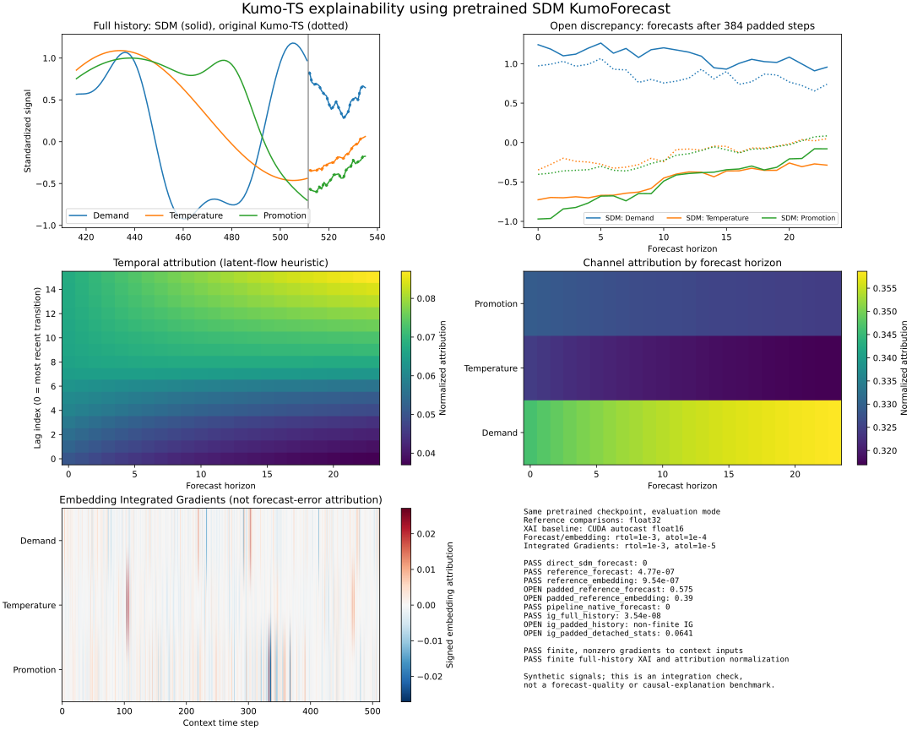
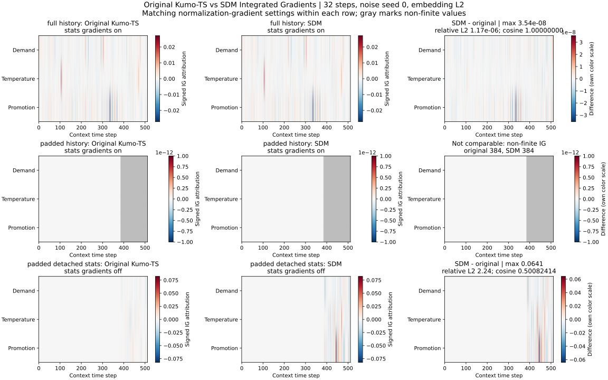

# SDM interpretability proof

This branch accepts an SDM `KumoForecast` through its forward interface and extracts embeddings with a temporary encoder hook. The example uses pretrained weights and produces visual and machine-readable comparisons.



## Run

From `Kumo-Forecast/`, prepare a Python 3.11 environment and install the pinned SDM main revision:

```bash
uv sync --frozen --python 3.11
uv pip install --python .venv/bin/python \
  'pyarrow==19.0.1' \
  'structured-data-models @ git+https://github.com/NVIDIA/structured-data-models.git@b2debca30051db5bc88c963f331e993cce2e4eda' \
  matplotlib
.venv/bin/python examples/sdm_interpretability_proof.py \
  --output examples/sdm_proof/snapshot
```

This pins SDM main at `b2debca30051db5bc88c963f331e993cce2e4eda`, including [input-gradient support, PR #1411](https://github.com/NVIDIA/structured-data-models/pull/1411). SDM detects input tensors with `requires_grad=True` automatically. The integration no longer supplies a gradient-only callback. Input tensors still need to request gradients for gradient-based explanations; model parameters can remain frozen.

The first run downloads the original MOMENT backbone and the Kumo-Forecast checkpoint. `--offline` restricts the original reference loader to cached files. Validation used an NVIDIA L4 and PyTorch `2.12.1+cu130`. CPU execution is available with `--device cpu`.

The example generates `overview.svg`, `overview.png`, `ig_comparison.svg`, `ig_comparison.png`, `results.json`, and `arrays.npz`. SVG and JSON snapshots are committed; PNGs and numerical arrays can be regenerated. `results.json` records the actual SDM revision, checkpoint revision, source hashes, precision, shapes, tolerances, and non-finite counts. Missingness-aware Kumo-Forecast weights are not exercised.

## Removing the gradient callback

A pretrained control run on the same SDM revision restored only the previous `_gradient_mode` / `_forecast_tensor` implementation from fork commit `e87ff32f3723c238d61b4b1f8677669774e61fce`. Both runs used matching explicit normalization-statistic gradient settings, identical inputs, weights, precision, and random seeds.

All **17 saved arrays were exactly equal**, including forecasts, embeddings, temporal and channel attributions, the latent trajectory, Integrated Gradients, and channel stability. The context-gradient norm was exactly `4.21182918548584` in both runs. Non-finite positions in padded Integrated Gradients were also identical; this does not make those attributions valid.

[snapshot/gradient_callback_comparison.json](snapshot/gradient_callback_comparison.json) records each compared array, finite-value errors, non-finite counts, and the baseline callback source hash. This control compares callback activation on current SDM main, rather than claiming equality across every historical SDM revision.

## Comparison with original Kumo-TS

The deterministic synthetic three-channel input is already standardized, matching the existing Kumo-TS interpretability boundary. The integration uses an identity SDM recipe to avoid standardizing twice. Both implementations load `run8_best_model_cr.pt` from checkpoint revision `abff20a58834638b28227ff4ab934f26206e4b09`.

| Check | Recorded result |
| --- | --- |
| Integration forecast versus direct SDM forward | Maximum absolute error `0` |
| Full-history forecast versus original Kumo-TS | Maximum absolute error `4.77e-7` |
| Full-history embedding versus original Kumo-TS | Maximum absolute error `9.54e-7` |
| Explanation baseline versus direct SDM at matching precision | Maximum absolute error `0` |
| Padded forecast versus original Kumo-TS | Maximum absolute error `0.575`; mismatch |
| Padded embedding versus original Kumo-TS | Maximum absolute error `0.390`; mismatch |

Reference comparisons use float32, `rtol=1e-3`, and `atol=1e-4`. The existing rollout uses CUDA autocast, so the explanation baseline is compared with a direct SDM call at the same precision.

The padded cases contain 384 masked leading steps. Their disagreement with original Kumo-TS already occurs with the old gradient callback on this SDM revision. The earlier snapshot pinned an attention-mask version of SDM PR #1338 that is not the implementation on current main; its padded embedding agreement no longer applies. These mismatches are reported, not asserted to pass.

## Integrated Gradients



Both implementations use the unchanged `integrated_gradients_embedding()` algorithm: 32 midpoint steps, noise baseline with seed `0`, one baseline, float32, internal batch size `1`, and the embedding L2 objective.

| Case | Maximum absolute attribution error | Result |
| --- | --- | --- |
| Full history, statistic gradients enabled | `3.54e-8` | Agreement; relative L2 error `1.17e-6` |
| Padded history, statistic gradients enabled | Not comparable | Both contain 384 non-finite values |
| Padded history, statistic gradients disabled | `0.0641` | Finite, but disagreement; relative L2 error `2.24` |

Full-history completeness residuals are `7.28e-4` for original Kumo-TS and `7.33e-4` for SDM. The detached-statistics padded control has residuals `6.52` and `1.21`, respectively, and is not a numerical-quality fix or a full derivative of the input-to-embedding function.

Current SDM RevIN statistics already participate in autograd. The normalization contextmanager retains its stable-statistics derivative when enabled and explicitly disables statistic gradients for the detached control. Both scopes restore the original methods. Removing the callback does not remove this separate normalization control.

## Scope and regression checks

This validates the interpretability integration, not forecast quality or causal explanations. The standard SDK continues to load its original model. Surrogate fitting, retrieval/DARR, and multi-GPU execution are outside the pretrained proof. Rolling windows without a fully observed patch have undefined pooled embeddings; the existing trajectory pipeline warns and replaces those states with zero.

```bash
.venv/bin/python -m pytest tests/test_interpretability.py sdk/tests/test_forecasting.py -q
```

Validation against the pinned SDM main revision: **102 passed, 2 skipped**. The skipped cases require a second CUDA device. Tests include gradients to inputs with frozen model parameters, forecasting and embedding integration, masking, replica-hook isolation and cleanup, SDK reporting, and scoped normalization-statistic gradients.
